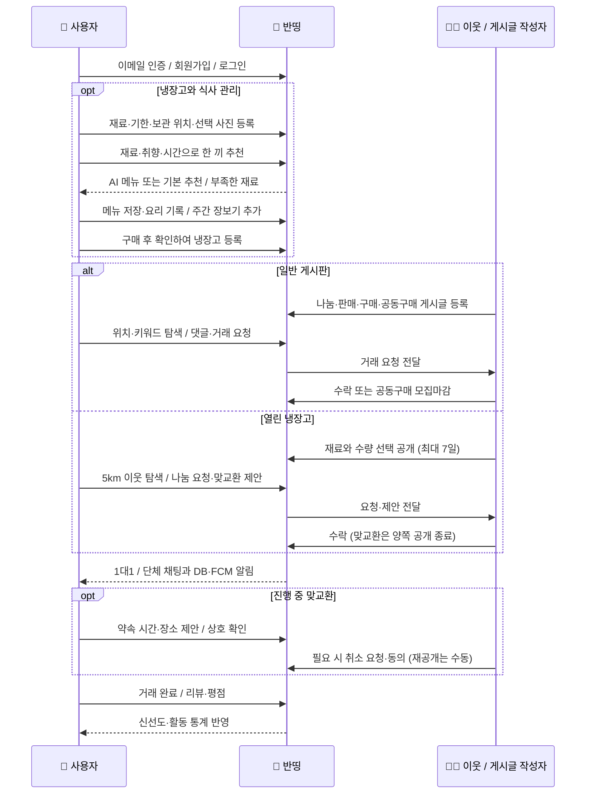
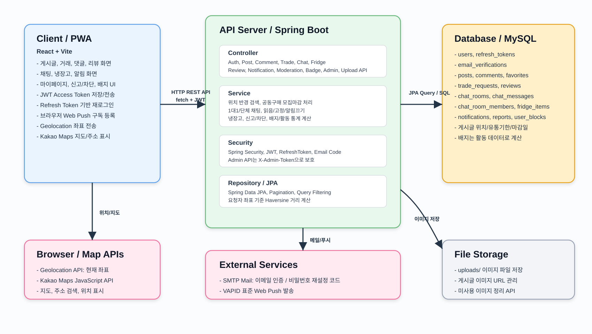
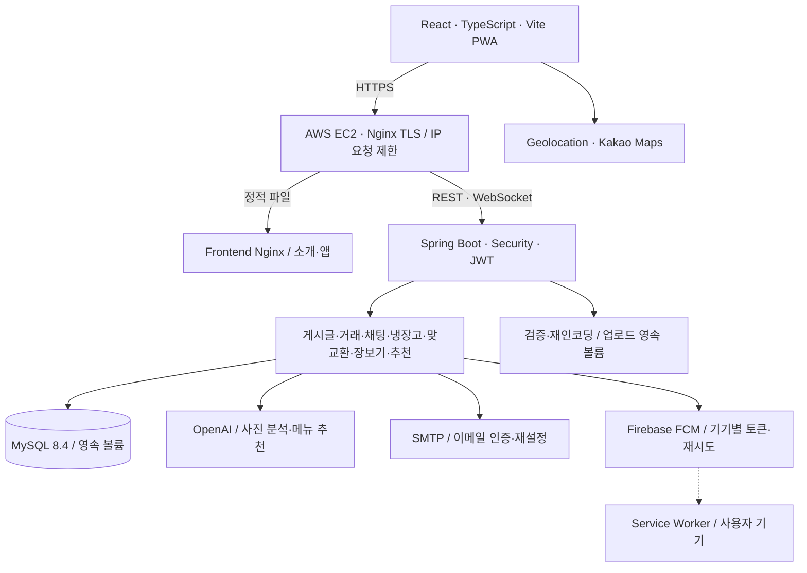
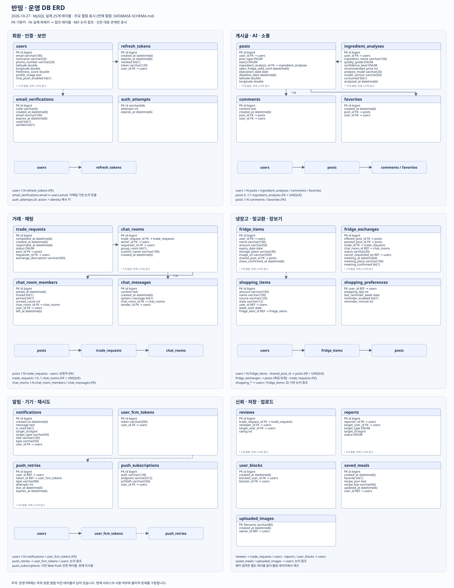

# 반띵
<p align="center">
  
</p>

<p align="center">
  <strong>위치 기반 식재료 공유 플랫폼</strong><br/>
  냉장고 관리부터 한 끼 추천·장보기·이웃 나눔과 맞교환까지 연결하는 위치 기반 식재료 공유 서비스
</p>

<p align="center">
  
  
  
  
  
  
  
  
</p>

---


## 최근 서버 기능 반영

운영 서비스: [bantting.store](https://bantting.store) · 문서 확인: 2026-10-27

현재 운영 서버의 소스와 DB 구조를 기준으로 냉장고 사진·선택 공개, 맞교환 약속·합의 취소, AI 추천·저장 메뉴, 주간 장보기·이월·선택 알림, 인증 제한과 푸시 재시도를 반영했습니다. 실행 환경변수와 배포 안내는 아래 **시작하기** 및 [서버 변경 통합 문서](docs/SERVER-SYNC.md)를 참고하세요.

## 📖 소개

**반띵**은 혼자 쓰기엔 많고 버리기엔 아까운 식재료를 가까운 이웃과 나눌 수 있도록 돕는 **위치 기반 식재료 공유 플랫폼**입니다.

사용자는 보유한 식재료를 나눔·판매·구매·공동구매 게시글로 등록하고, 주변 사용자는 게시글을 탐색한 뒤 댓글이나 거래 요청을 통해 공유에 참여할 수 있습니다.

식재료는 일반 중고 물품보다 신선도, 유통기한, 거래 위치, 사용자 신뢰도가 중요하기 때문에 반띵은 게시글 작성부터 거래 완료, 리뷰와 평점까지 이어지는 흐름을 하나의 서비스 경험으로 설계했습니다.

### ✨ 주요 특징

| 기능 | 설명 |
|------|------|
| 📍 **위치 기반 탐색** | 사용자 위치와 거리 조건을 기준으로 주변 식재료 게시글 조회 |
| 🥬 **식재료 게시판** | 나눔, 판매, 구매, 공동구매 목적에 맞춰 식재료 게시글 등록·수정·삭제 |
| 🛒 **공동구매 모집** | 목표 인원과 날짜·시간 마감일을 설정하고, 모집마감 시 1대1 또는 단체 채팅방 개설 |
| 🔍 **검색과 필터링** | 게시글 타입, 키워드, 거리, 유통기한 임박순, 신선도순, 가격순 등 조건별 조회 |
| 📄 **페이지네이션** | 게시글, 댓글, 알림, 리뷰 목록을 `page`/`size` 기준으로 나눠 조회 |
| 💬 **댓글 소통** | 게시글에 대한 문의와 거래 전 소통을 위한 댓글 기능 |
| 🤝 **거래 요청** | 관심 있는 게시글에 거래 요청을 보내고 작성자가 수락·거절하고 거래 당사자가 완료 처리, 완료 게시글은 일반 목록에서 숨김 |
| 💬 **채팅** | 거래 수락 후 1대1 채팅방을 열고, 공동구매 모집마감 시 참여자 단체 채팅방 개설 |
| 📌 **채팅방 관리** | 채팅방 읽음 처리, 상단 고정, 알림 끄기, 상대 프로필 이미지 표시 |
| ⭐ **리뷰와 평점** | 완료된 거래를 기반으로 리뷰를 작성하고 사용자 신뢰도 확인 |
| ❤️ **관심 게시글** | 다시 보고 싶은 게시글을 관심 목록으로 저장 |
| 🔔 **알림 설정** | 거래와 서비스 알림, DB 알림 목록, 기기별 FCM 토큰 등록 및 푸시 전송 |
| 🔐 **회원 인증** | JWT·Refresh Token 기반 로그인, 이메일 인증, 비밀번호 재설정 코드 인증, 닉네임·이메일·전화번호 중복 확인 제공 |
| 🖼️ **이미지 업로드** | 사진 디코딩·JPEG 재인코딩·크기 조정과 업로더 소유권 검증 |
| 🚨 **신고와 차단** | 사용자·게시글·댓글 신고, 사용자 차단/해제, 차단 사용자 콘텐츠 숨김 |
| 🏅 **배지와 업적** | 게시글 작성, 나눔, 판매, 공동구매, 거래 완료, 리뷰, 평점 기반 배지 진행률 제공 |
| 📊 **활동 통계** | 나눔 완료, 판매 완료, 공구 참여 수를 실제 완료 거래 기준으로 집계 |
| 🧊 **내 냉장고** | 재료·수량·기한·보관 위치·메모·선택 사진 관리, 오늘부터 3일 이내 임박 재료와 지난 재료 구분 |
| 🍳 **한 끼 추천** | 냉장고 재료와 요리 취향·시간을 반영한 AI 추천, 실패 시 기본 레시피 제공, 저장 메뉴·최근 요리 기록 |
| 🤖 **식재료 사진 분석** | 보관 조건과 사진 기반 품질·소비기간 추정, 구매가격 기반 권장 판매가격 제안 |
| 🏘️ **열린 냉장고** | 선택한 재료만 공개해 5km 이웃과 나눔, 최대 7일 공개, 일반 게시판과 분리 |
| 🔄 **냉장고 맞교환** | 서로 공개한 재료 교환 제안, 수락·채팅·약속 확인·완료·상호 동의 취소 |
| 📝 **주간 장보기** | 부족한 재료와 직접 입력한 품목 관리, 선택 알림, 미구매 품목 이월, 구매 후 확인하여 냉장고 등록 |
| 📱 **PWA** | 소개 페이지와 설치형 앱, 위치·알림 권한 안내, 로그인 유지 및 모바일 뒤로가기 처리 |
| 🛠️ **관리자 기능** | 서비스 통계 조회, 신고 목록 확인, 신고 처리 상태 변경 API 제공 |

---

## 🎯 기획 배경

반띵은 다음 문제의식에서 출발했습니다.

- 냉장고에 남아 있는 식재료가 사용되지 못하고 버려지는 경우가 많음
- 필요한 양보다 많이 사야 하는 식재료를 이웃과 나누거나 공동구매할 수 있는 방법이 필요함
- 식재료 공유는 가까운 거리에서 빠르게 이루어지는 것이 중요함
- 유통기한과 상태 확인이 필요한 만큼 거래 전후의 신뢰 장치가 필요함

따라서 반띵은 **식재료 낭비 감소**, **지역 기반 공유 활성화**, **신뢰 기반 거래 환경 제공**을 목표로 합니다.

---

## 🧭 서비스 흐름



---

## 🏗️ 아키텍처



운영 서버는 AWS EC2에서 Nginx·프론트엔드·Spring Boot·MySQL 컨테이너를 실행합니다. Nginx가 HTTPS를 종료하고 `/api/`, `/ws/`, `/uploads/`를 백엔드로 전달합니다. MySQL과 업로드 파일은 Docker 볼륨에 유지하며, RDS 구성 파일은 선택 배포 예시입니다.



---

## 🧩 핵심 도메인

### 👤 사용자

이메일, 비밀번호, 닉네임, 전화번호, 위치 정보를 기반으로 회원을 관리합니다.

로그인 이후 발급되는 Access Token과 Refresh Token을 통해 게시글 작성, 거래 요청, 리뷰 작성, 신고/차단, 배지 조회, 마이페이지 조회처럼 인증이 필요한 기능을 사용할 수 있습니다. 회원가입은 이메일 인증 완료 후 진행되며, 비밀번호 재설정도 이메일 인증 코드를 검증한 뒤 처리됩니다. 로그아웃이나 비밀번호 재설정 시 저장된 Refresh Token은 무효화됩니다.

### 🥬 게시글

게시글은 식재료 공유 목적에 따라 `SHARE`, `SALE`, `BUY`, `GROUP_BUY`로 구분됩니다.

식재료명, 수량, 가격, 거래 위치, 거리, 유통기한, 거래 마감일, 이미지, 상세 설명을 함께 저장하여 사용자가 식재료 상태와 거래 조건을 확인할 수 있도록 구성했습니다.

나눔·판매 게시글은 유통기한과 별도로 거래 마감일을 둘 수 있고, 공동구매 게시글은 날짜와 시간을 포함한 모집 마감일을 관리합니다.

| 타입 | 설명 |
|------|------|
| `SHARE` | 무료 나눔 |
| `SALE` | 판매 |
| `BUY` | 구매 요청 |
| `GROUP_BUY` | 공동구매 |

### 💬 댓글

게시글 상세 화면에서 문의나 거래 전 확인이 필요한 내용을 댓글로 주고받을 수 있습니다.

작성자는 자신의 댓글을 수정하거나 삭제할 수 있습니다.

### 🛒 공동구매

공동구매 게시글은 `GROUP_BUY` 타입으로 등록되며, 일반 나눔·판매 게시글과 달리 목표 인원과 날짜·시간 마감일 정보를 함께 관리합니다.

사용자는 공동구매 게시판에서 진행 중인 모집글을 확인하고, 거래 요청을 통해 참여 의사를 전달할 수 있습니다. 작성자는 신청자 목록을 확인한 뒤 목표 인원이 모두 채워지지 않아도 모집마감을 눌러 현재 대기·수락된 참여자와 함께 공동구매 채팅방을 열 수 있습니다.

신청자가 1명이면 1대1처럼, 여러 명이면 단체 채팅방처럼 동작합니다. 목표 인원은 모집 규모를 표시하고 추가 요청을 제한하는 기준으로 사용되며, 개별 수락으로 목표 인원이 채워지면 게시글이 닫힙니다. 작성자의 모집마감 처리로도 닫히며, 마감일이 지난 요청은 제한됩니다.

| 항목 | 설명 |
|------|------|
| 목표 인원 | 공동구매 모집에 필요한 전체 참여 인원 |
| 현재 참여 인원 | 현재까지 참여한 사용자 수 |
| 마감일 | 날짜와 시간을 포함한 공동구매 모집 종료 시점 |

### 🤝 거래 요청

사용자는 원하는 게시글에 거래 요청을 보낼 수 있고, 게시글 작성자는 요청을 수락·거절하고, 수락된 거래의 당사자는 완료 처리할 수 있습니다. 일반 나눔/판매 게시글은 거래 요청 수락 시 게시글이 닫히며, 다른 대기 요청은 거절됩니다.

거래 완료된 게시글은 홈/게시판/검색/거리 필터 결과에서는 숨겨지지만, 작성자의 내정보 > 내 게시글에는 남아 상세 화면으로 다시 진입할 수 있습니다. 완료된 게시글에서는 추가 거래 요청과 댓글 작성이 제한됩니다.

공동구매는 개별 요청 수락도 가능하고, 모집마감 시 현재 대기·수락 요청을 함께 수락하여 공동구매 채팅방을 개설합니다.

| 상태 | 설명 |
|------|------|
| `PENDING` | 거래 요청 대기 |
| `ACCEPTED` | 거래 요청 수락 |
| `REJECTED` | 거래 요청 거절 |
| `COMPLETED` | 거래 완료 |
| `CANCELLED` | 맞교환 합의 취소로 연결 거래 종료 |

### 💬 채팅

나눔·판매·구매 요청 수락 시 1대1 채팅방이 열리고 공동구매는 모집마감 시 참여자 단체방을 구성합니다. 맞교환 수락도 거래와 채팅으로 연결됩니다.

REST 메시지 조회·전송과 WebSocket 실시간 수신을 함께 사용합니다. 참여자 권한과 차단 관계를 확인하며, 읽음·읽지 않은 수·고정·알림 끄기·방 이름·참여자 프로필을 제공합니다. 방 나가기는 개인의 `left_at`을 기록하여 접근을 종료하며 다른 참여자의 메시지 기록을 삭제하지 않습니다. 개인 채팅 알림 설정과 기기별 FCM 연결을 반영합니다.

### 🧊 내 냉장고

재료명, 수량, 기한, 냉장·냉동·실온 보관 위치, 메모와 선택 사진을 계정별로 관리합니다. 오늘부터 3일 이내 재료를 임박 재료로 집계하고, 지난 재료는 별도로 표시합니다. 사진만 변경하는 전용 API는 공개 여부나 수량을 바꾸지 않습니다. 일반 재료 수정·삭제는 기존 공개를 종료하고 대기 요청을 거절하므로, 수정한 재료는 확인 후 다시 공개합니다.

### 🍳 한 끼 추천과 저장 메뉴

선택한 냉장고 재료, 추가 재료, 원하는 요리·취향과 최대 조리시간을 받아 메뉴를 추천합니다. 기한이 지난 냉장고 재료는 제외하고 임박 재료를 구분합니다. AI 응답이 없거나 호출 제한·오류가 발생하면 내장 레시피로 대체하며, 응답의 `mode`로 구분합니다. 보유 재료·부족한 재료·조리 단계가 함께 표시되고, 메뉴 저장과 최근 요리 기록을 지원합니다. 요리 기록을 남겨도 재료 수량을 자동 차감하지 않습니다.

### 🤖 식재료 사진 분석

사진과 보관 방법, 개봉 여부, 구매일, 수량, 선택 구매가격을 입력받아 AI로 재료명·품질 등급·소비기간 범위·신뢰도를 추정합니다. 권장가격과 빠른 판매가격은 서버의 가격 정책으로 계산합니다. 분석 결과는 본인만 24시간 이내 한 게시글에 연결할 수 있습니다. 사진 분석은 식품 안전을 보증하지 않으며, AI 연결 실패 시 오류를 반환합니다. 한 끼 추천의 기본 레시피 대체 동작과 구분됩니다.

### 🏘️ 열린 냉장고

개인 냉장고 전체가 아니라 사용자가 재료와 나눌 수량을 선택해 공개합니다. 위치를 설정한 5km 이내 이웃에게 재료명·수량·기한·선택 사진과 동네·거리 정보를 보여주며, 개인 메모나 정확한 주소·좌표는 이웃 응답에 포함하지 않습니다.

공개는 최대 7일이며 식재료 기한 종료 시 더 일찍 만료됩니다. 차단 관계와 만료·거래 상태를 반영해 탐색합니다. 내부적으로 `SHARE` 게시글과 거래 요청을 연결하지만 일반 게시판·검색·내 게시글·관심 목록에는 노출하지 않습니다. 나눔 요청 수락 후 기존 거래·채팅 흐름을 사용합니다.

### 🔄 냉장고 맞교환

5km 이내 두 사용자가 각각 공개한 재료를 선택해 맞교환을 제안합니다. 수락하면 두 재료의 공개를 닫고 거래 요청과 1대1 채팅방을 생성합니다. 진행 중에는 만날 시간·장소를 제안하고 상대가 확인할 수 있습니다. 대기 제안은 제안자가 취소하거나 상대가 거절할 수 있고, 수락 후에는 취소 요청·동의·거절·철회를 지원합니다. 취소 합의 시 예약이 해제되며 재료 상태를 확인한 뒤 직접 다시 공개해야 합니다. 취소 요청 중에는 완료 처리를 제한합니다.

### 📝 주간 장보기

월요일을 기준으로 계정별 주간 목록을 저장합니다. 추천 메뉴의 부족한 재료 또는 직접 입력한 품목을 `NEED`(살 것), `HAVE`(있음), `BOUGHT`(구매 완료)로 관리합니다. 선택한 미구매 품목은 다음 주로 복사하며, 원래 목록을 지우거나 수량·단위를 임의로 합산하지 않습니다.

사용자가 알림을 켠 경우, 한국 시간 기준 지정 요일·시간 이후 살 품목이 남아 있는 주에 1회 앱 알림을 생성합니다. 구매 완료만으로 냉장고에 자동 등록하지 않으며, 사용자가 수량·기한·보관 위치를 확인한 뒤 등록합니다. 같은 구매 항목의 중복 등록을 방지합니다.

### ⭐ 리뷰

거래가 완료된 뒤에는 상대 사용자에 대한 리뷰와 평점을 남길 수 있습니다.

리뷰는 거래 이후의 신뢰 정보를 쌓기 위한 장치이며, 사용자는 다른 사용자의 평점과 리뷰 목록을 조회할 수 있습니다.

### 🔔 알림

댓글·거래·채팅·유통기한 임박·맞교환·주간 장보기 이벤트를 DB 알림과 FCM 푸시로 연결합니다. 읽음·미읽음 개수·개별 삭제·읽은 알림 삭제·전체 삭제를 지원하며, 전체 삭제에는 미읽은 알림도 포함됩니다.

여러 기기의 FCM 토큰을 관리하고, 일시 실패는 `push_retries`에 저장해 최대 5회·1시간 이내 제한적으로 재시도합니다. 무효 토큰은 제거합니다. 실제 기기 수신은 브라우저·OS 권한과 유효한 토큰에 따라 달라집니다.

### 🚨 신고와 차단

사용자는 부적절한 사용자, 게시글, 댓글을 신고할 수 있고, 특정 사용자를 차단하거나 차단 해제할 수 있습니다. 차단 관계가 있으면 댓글 작성과 거래 요청이 제한되며, 로그인 사용자의 목록에서는 차단된 사용자의 콘텐츠가 숨겨집니다.

### 🏅 배지와 업적

배지와 업적은 실제 활동 데이터를 기준으로 계산됩니다. 게시글 작성, 나눔, 판매, 공동구매 참여, 거래 완료, 받은 리뷰 수, 평균 평점에 따라 진행률과 획득 여부를 제공합니다.

### 🛠️ 관리자

관리자 API는 서비스 통계와 신고 처리를 위한 기능입니다. 전체 사용자 수, 게시글 수, 거래 완료 수, 신고 수를 확인할 수 있고, 신고 목록을 페이지 단위로 조회하거나 신고 상태를 변경할 수 있습니다. 일반 JWT 인증 외에 서버의 `APP_ADMIN_TOKEN`과 일치하는 `X-Admin-Token` 헤더를 확인합니다.

---

## 📊 데이터 설계



운영 DB의 25개 테이블과 실제 외래키를 확인했습니다. 그림의 실선은 DB 외래키, 점선은 ID 기반 논리 참조이며 대표 관계를 표시합니다. 전체 컬럼과 외래키는 [스키마 목록](docs/DATABASE-SCHEMA.md)에 정리했습니다.

| 데이터 | 설명 |
|---|---|
| `users` | 회원·위치·신선도·개인 알림/채팅 설정 |
| `email_verifications / refresh_tokens / auth_attempts` | 이메일 검증, 토큰 만료·무효화, 계정별 시도 제한 |
| `posts / ingredient_analyses` | 4종 게시글·열린 냉장고 내부 공개 기록, 본인 AI 분석 연결 |
| `comments / favorites` | 댓글과 일반 게시판 관심 등록 |
| `trade_requests` | PENDING / ACCEPTED / REJECTED / COMPLETED / CANCELLED |
| `chat_rooms / chat_room_members / chat_messages` | 거래별 방, 참여자별 나가기·읽음·고정·음소거, 메시지 |
| `fridge_items / fridge_exchanges` | 사진·보관 위치·선택 공개, 맞교환 예약·약속·합의 취소 |
| `shopping_items / shopping_preferences` | 주간 품목·구매 상태·냉장고 등록, 요일·선택 알림 |
| `saved_meals` | 레시피 JSON, 저장 여부·최근 요리 시각 |
| `notifications / user_fcm_tokens / push_retries` | 앱 알림·기기 토큰·제한적 푸시 재시도 |
| `uploaded_images` | 검증한 파일명과 업로더 소유권 |
| `reviews / reports / user_blocks` | 거래 리뷰·신고·차단 |
| `push_subscriptions` | 운영 DB에 남아 있는 이전 Web Push 테이블; 현재 코드의 FCM 저장소와 구분 |

배지·업적은 별도 테이블이 아니라 활동 데이터로 계산합니다.

---

## 📂 프로젝트 구조

```bash
foodshare/
├── docs/
│   ├── README.md                      # 문서 모음 안내
│   ├── API.md                         # API 명세 문서
│   ├── deployment/                    # Docker/AWS 배포 문서
│   ├── images/                        # 아키텍처, ERD, 시퀀스 이미지
│   └── design/                        # 소프트웨어 설계서
│
├── docker/                            # 프론트엔드 Nginx 설정
├── nginx/                             # 통합 배포용 Reverse Proxy 설정
├── scripts/                           # 동기화 및 문서 보조 스크립트
│
├── public/
│   ├── assets/                        # PWA 아이콘, 기본 이미지 자산
│   ├── manifest.webmanifest           # PWA 매니페스트
│   └── firebase-messaging-sw.js       # PWA/FCM 서비스워커
│
├── src/
│   ├── app/                           # React 화면, 컴포넌트, API 클라이언트
│   │   ├── api/
│   │   └── components/
│   │       ├── auth/                  # 로그인, 회원가입, 아이디/비밀번호 찾기
│   │       ├── board/                 # 게시판, 게시글 작성, 상세 화면
│   │       ├── chat/                  # 채팅방 목록, 채팅 메시지, 채팅방 설정
│   │       ├── category/              # 카테고리 선택
│   │       ├── common/                # 공통 UI, 알림 화면, 이미지 표시
│   │       ├── fridge/                # 냉장고 식재료 관리
│   │       └── profile/               # 마이페이지, 관심 목록, 설정
│   │
│   ├── styles/                        # 프론트엔드 스타일
│   ├── intro/                         # 서비스 소개 페이지
│   ├── main.tsx                       # 프론트엔드 진입점
│   │
│   ├── main/
│   │   ├── java/com/hjs/foodshare/
│   │   │   ├── auth/                  # 회원가입, 로그인, 인증
│   │   │   ├── post/                  # 게시글
│   │   │   ├── comment/               # 댓글
│   │   │   ├── favorite/              # 관심 게시글
│   │   │   ├── ai/                    # 식재료 사진 분석·가격 정책
│   │   │   ├── meal/                  # 메뉴 추천·저장·최근 요리
│   │   │   ├── shopping/              # 주간 장보기·알림·이월
│   │   │   ├── fridge/                # 냉장고·열린 냉장고·맞교환
│   │   │   ├── trade/                 # 거래 요청
│   │   │   ├── chat/                  # 1대1/공동구매 채팅, 읽음, 고정, 알림 끄기
│   │   │   ├── review/                # 리뷰
│   │   │   ├── mypage/                # 마이페이지
│   │   │   ├── admin/                 # 관리자 통계, 신고 처리
│   │   │   ├── notification/          # 알림, FCM, 유통기한 임박 알림
│   │   │   ├── moderation/            # 신고, 차단
│   │   │   ├── badge/                 # 배지, 업적
│   │   │   ├── upload/                # 이미지 업로드
│   │   │   └── global/                # 공통 응답, 예외, 보안
│   │   └── resources/
│   │       └── application.yml
│   │
│   └── test/                          # 서버 테스트
│
├── package.json                       # 프론트엔드 실행 / 빌드
├── build.gradle                       # 서버 실행 / 빌드
├── docker-compose.yml                 # 로컬 Docker 통합 실행
├── docker-compose.rds.yml             # AWS RDS 연동 Docker 실행 예시
├── docker-compose.production.yml      # EC2 HTTPS 운영 구성
├── Dockerfile.backend                 # Spring Boot 컨테이너 빌드
├── Dockerfile.frontend                # React 정적 빌드/Nginx 컨테이너 빌드
├── gradlew
├── gradlew.bat
└── README.md
```

---

## 🛠️ 기술 스택

| 구분 | 기술 |
|------|------|
| Frontend | React 18, TypeScript, Vite 6 |
| UI | MUI, Radix UI, Lucide React, Motion |
| Backend | Java 21, Spring Boot 4.0.6 |
| Web | Spring Web MVC |
| Security | Spring Security, JWT, Refresh Token, BCrypt |
| Database | MySQL 8.4 (운영 Docker) |
| ORM | Spring Data JPA, Hibernate |
| Validation | Jakarta Validation |
| Mail | Spring Boot Mail, Angus Mail |
| Push | Firebase Cloud Messaging (FCM) |
| Build | Gradle, npm |
| Test | JUnit Platform, H2 Database |
| Library | Lombok, TwelveMonkeys ImageIO (WebP 읽기) |
| AI | 서버에서 OpenAI Responses API 호출, `OPENAI_MODEL`로 모델 선택 |
| Deployment | AWS EC2, Docker Compose, Nginx, HTTPS |

---

## 🔐 인증 방식

반띵은 JWT 기반 인증 방식을 사용합니다.

로그인 성공 시 발급된 Access Token을 인증이 필요한 요청의 `Authorization` 헤더에 포함합니다.

```http
Authorization: Bearer {accessToken}
```

인증 흐름은 다음과 같습니다.

1. 사용자가 회원가입 또는 로그인을 요청합니다.
2. 서버는 사용자 정보를 검증한 뒤 Access Token을 발급합니다.
3. 클라이언트는 토큰을 저장합니다.
4. 게시글 작성, 거래 요청, 리뷰 작성 등 인증이 필요한 API 요청에 토큰을 포함합니다.
5. 서버는 JWT를 검증하고 현재 로그인한 사용자를 식별합니다.
6. 만료 전 또는 401 응답 시 Refresh Token으로 갱신하고 요청을 한 번 재시도합니다. 동시 갱신을 조정하고 로그아웃·계정 전환 중에는 이전 세션을 복원하지 않습니다.

Access Token은 기본 24시간, Refresh Token은 14일입니다. 로그아웃·비밀번호 재설정은 Refresh Token을 무효화합니다. 계정별 인증 시도 제한과 운영 Nginx의 IP 요청 제한을 함께 적용합니다. 휴대폰 인증 엔드포인트는 코드 생성·검증 구현이며 실제 SMS 발송 연동은 포함하지 않습니다.

---

## 📌 주요 API

### Auth

| Method | URL | 설명 |
|------|------|------|
| POST | `/api/auth/signup` | 회원가입 |
| POST | `/api/auth/login` | 로그인 |
| POST | `/api/auth/refresh` | Refresh Token 기반 Access Token 재발급 |
| POST | `/api/auth/logout` | 로그아웃 및 Refresh Token 무효화 |
| POST | `/api/auth/find-email` | 이메일 찾기 |
| POST | `/api/auth/find-id` | 아이디 찾기 |
| POST | `/api/auth/password-reset-link` | 비밀번호 재설정 인증 코드 발송 |
| POST | `/api/auth/reset-password` | 이메일 인증 코드 기반 비밀번호 재설정 |
| POST | `/api/auth/phone-verifications` | 휴대폰 인증 코드 생성 (SMS 발송 미연동) |
| POST | `/api/auth/phone-verifications/verify` | 휴대폰 인증번호 검증 |
| GET | `/api/auth/nickname/check` | 닉네임 중복 확인 |
| GET | `/api/auth/email/check` | 이메일 중복 확인 |
| GET | `/api/auth/phone/check` | 전화번호 중복 확인 |
| POST | `/api/auth/email-verifications` | 이메일 인증번호 발송 |
| POST | `/api/auth/email-verifications/verify` | 이메일 인증번호 검증 |

### Posts

| Method | URL | 설명 |
|------|------|------|
| POST | `/api/posts` | 게시글 작성 |
| POST | `/api/posts/create` | 게시글 작성 |
| GET | `/api/posts` | 게시글 목록 조회 |
| GET | `/api/posts/page` | 게시글 목록 페이지 조회 |
| GET | `/api/posts/{postId}` | 게시글 상세 조회 |
| PUT | `/api/posts/{postId}` | 게시글 수정 |
| DELETE | `/api/posts/{postId}` | 게시글 삭제 |

게시글 타입은 다음 네 가지로 구분됩니다.

| 타입 | 설명 |
|------|------|
| `SHARE` | 무료 나눔 |
| `SALE` | 판매 |
| `BUY` | 구매 요청 |
| `GROUP_BUY` | 공동구매 |

게시글 목록 조회는 다음 조건을 지원합니다.

```text
postType=SHARE | SALE | BUY | GROUP_BUY
keyword=상추
maxDistanceKm=1.0
lat=37.5001
lng=127.0361
radiusKm=1.0
expiringSoon=true
sort=LATEST | EXPIRING_SOON | DISTANCE | FRESHNESS | PRICE_LOW
```

### Comments

| Method | URL | 설명 |
|------|------|------|
| POST | `/api/posts/{postId}/comments` | 댓글 작성 |
| GET | `/api/posts/{postId}/comments` | 게시글 댓글 조회 |
| GET | `/api/posts/{postId}/comments/page` | 게시글 댓글 페이지 조회 |
| PUT | `/api/comments/{commentId}` | 댓글 수정 |
| DELETE | `/api/comments/{commentId}` | 댓글 삭제 |

### Favorites

| Method | URL | 설명 |
|------|------|------|
| POST | `/api/posts/{postId}/favorite` | 관심 게시글 등록 |
| DELETE | `/api/posts/{postId}/favorite` | 관심 게시글 해제 |
| GET | `/api/posts/{postId}/favorite` | 관심 여부 조회 |
| GET | `/api/favorites` | 내 관심 게시글 조회 |

### Trade Requests

| Method | URL | 설명 |
|------|------|------|
| POST | `/api/posts/{postId}/requests` | 거래 요청 생성 |
| POST | `/api/posts/{postId}/trade-requests` | 거래 요청 생성 |
| GET | `/api/posts/{postId}/trade-requests` | 특정 게시글의 거래 요청 조회 |
| GET | `/api/trade-requests/me` | 내가 보낸 거래 요청 조회 |
| GET | `/api/trade-requests/received` | 내가 받은 거래 요청 조회 |
| POST/PATCH/PUT | `/api/trade-requests/{requestId}/accept` | 거래 요청 수락 |
| POST/PATCH/PUT | `/api/trade-requests/{requestId}/reject` | 거래 요청 거절 |
| POST/PATCH/PUT | `/api/trade-requests/{requestId}/complete` | 거래 완료 처리 |
| POST/PATCH/PUT | `/api/posts/{postId}/group-buy/close-recruitment` | 공동구매 모집마감 및 채팅방 개설 |

### Chat

| Method | URL | 설명 |
|------|------|------|
| GET | `/api/chat/rooms` | 내 채팅방 목록 조회 |
| GET | `/api/chat/rooms/by-trade-request/{tradeRequestId}` | 거래 요청 기준 채팅방 조회 |
| GET | `/api/chat/rooms/{roomId}/messages` | 채팅 메시지 조회 |
| POST | `/api/chat/rooms/{roomId}/messages` | 채팅 메시지 전송 |
| PATCH | `/api/chat/rooms/{roomId}/read` | 채팅방 읽음 처리 |
| PATCH | `/api/chat/rooms/{roomId}/pin` | 채팅방 상단 고정/해제 |
| PATCH | `/api/chat/rooms/{roomId}/mute` | 채팅방 알림 끄기/켜기 |
| PATCH | `/api/chat/rooms/{roomId}/name` | 채팅방 이름 변경 |
| DELETE | `/api/chat/rooms/{roomId}` | 개인별 방 나가기 |
| GET | `/api/chat/rooms/{roomId}/participants/{targetId}/profile` | 참여자 프로필 조회 |

### Fridge

| Method | URL | 설명 |
|------|------|------|
| GET | `/api/fridge/items` | 내 냉장고 식재료 조회 |
| POST | `/api/fridge/items` | 냉장고 식재료 등록 |
| PUT | `/api/fridge/items/{itemId}` | 냉장고 식재료 수정 |
| DELETE | `/api/fridge/items/{itemId}` | 냉장고 식재료 삭제 |

### AI Ingredient Analysis

| Method | URL | 설명 |
|---|---|---|
| POST | `/api/ai/ingredient-analysis` | 사진·보관 조건 기반 분석 (multipart/form-data) |

### Meals

| Method | URL | 설명 |
|---|---|---|
| POST | `/api/meals/recommend` | 재료·취향·시간 기반 메뉴 추천 |
| GET | `/api/meals/library` | 저장 메뉴·최근 요리 목록 |
| POST | `/api/meals/library` | 메뉴 저장 또는 요리 기록 |
| DELETE | `/api/meals/library/{id}` | 내 저장 메뉴 삭제 |

### Open Fridge

| Method | URL | 설명 |
|---|---|---|
| GET | `/api/open-fridge` | 5km 이웃의 공개 재료 검색 |
| GET | `/api/open-fridge/mine` | 내 재료 공개 상태 |
| PUT | `/api/open-fridge/{id}` | 재료·나눌 수량 확인 후 공개/갱신 |
| DELETE | `/api/open-fridge/{id}` | 공개 종료 |
| PUT | `/api/open-fridge/{id}/photo` | 선택 사진 변경·제거 |
| POST | `/api/open-fridge/{id}/requests` | 공개 재료 나눔 요청 |

### Fridge Exchanges

| Method | URL | 설명 |
|---|---|---|
| GET | `/api/fridge-exchanges` | 내 맞교환 제안·진행 내역 |
| POST | `/api/fridge-exchanges` | 내 공개 재료와 상대 공개 재료의 교환 제안 |
| POST | `/api/fridge-exchanges/{id}/{action}` | 수락·거절·취소·완료·약속 확인 |
| PUT | `/api/fridge-exchanges/{id}/meeting` | 교환 약속 시간·장소 제안 |

`action`: `accept`, `reject`, `cancel`, `complete`, `request-cancel`, `confirm-cancel`, `reject-cancel`, `withdraw-cancel`, `confirm-meeting`. 상태와 당사자 역할에 따라 허용합니다.

### Shopping

| Method | URL | 설명 |
|---|---|---|
| GET | `/api/shopping` | 주간 목록 및 냉장고 보유 재료 조회 |
| POST | `/api/shopping` | 주간 품목 추가 |
| PATCH | `/api/shopping/items/{id}` | 상태·수량 변경 |
| DELETE | `/api/shopping/items/{id}` | 내 품목 삭제 |
| PUT | `/api/shopping/preference` | 장보기 요일 설정 |
| PUT | `/api/shopping/reminder` | 선택 알림·시간 설정 |
| POST | `/api/shopping/carry` | 선택한 미구매 품목 다음 주 복사 |
| POST | `/api/shopping/items/{id}/fridge` | 구매 후 확인한 재료 냉장고 등록 |

### Reviews

| Method | URL | 설명 |
|------|------|------|
| POST | `/api/trade-requests/{requestId}/reviews` | 거래 요청 기반 리뷰 작성 |
| POST | `/api/users/{userId}/reviews` | 특정 사용자 대상 리뷰 작성 |
| GET | `/api/users/{userId}/reviews` | 특정 사용자 리뷰 조회 |
| GET | `/api/users/{userId}/reviews/page` | 특정 사용자 리뷰 페이지 조회 |
| GET | `/api/users/{userId}/rating` | 특정 사용자 평점 요약 조회 |
| GET | `/api/mypage/reviews` | 내가 작성한 리뷰 조회 |
| GET | `/api/mypage/reviews/page` | 내가 작성한 리뷰 페이지 조회 |

### My Page

| Method | URL | 설명 |
|------|------|------|
| GET | `/api/mypage` | 내 정보 요약 및 나눔 완료/판매 완료/공구 참여 통계 조회 |
| GET | `/api/mypage/posts` | 내가 작성한 게시글 조회 |
| GET | `/api/mypage/comments` | 내가 작성한 댓글 조회 |
| GET | `/api/mypage/trade-requests` | 내가 보낸 거래 요청 조회 |
| GET | `/api/mypage/received-trade-requests` | 내가 받은 거래 요청 조회 |
| GET | `/api/mypage/blocks`, `/api/mypage/blocked-users` | 차단 사용자 목록 조회 |
| GET | `/api/mypage/badges` | 내 배지/업적 조회 |
| PUT | `/api/mypage` | 프로필 수정 |
| PUT | `/api/mypage/location` | 위치 수정 |
| GET/PUT | `/api/mypage/chat-settings` | 개인 채팅 설정 조회·변경 |

### Notifications

| Method | URL | 설명 |
|------|------|------|
| GET | `/api/mypage/notifications/settings` | 알림 설정 조회 |
| PUT | `/api/mypage/notifications/settings` | 알림 설정 수정 |
| GET | `/api/notifications` | 알림 목록 조회 |
| GET | `/api/notifications/page` | 알림 목록 페이지 조회 |
| POST/PUT/PATCH | `/api/notifications/{notificationId}/read` | 알림 읽음 처리 |
| POST | `/api/notifications/fcm-token` | FCM 기기 토큰 등록 |
| DELETE | `/api/notifications/fcm-token` | FCM 기기 토큰 해제 |
| POST | `/api/notifications/test-push` | 테스트 푸시 알림 전송 |
| GET | `/api/notifications/unread-count` | 미읽음 개수 |
| DELETE | `/api/notifications/{notificationId}` | 내 알림 개별 삭제 |
| DELETE | `/api/notifications/read` | 읽은 알림 삭제 |
| DELETE | `/api/notifications` | 내 알림 전체 삭제 (미읽음 포함) |

### Reports / Blocks

| Method | URL | 설명 |
|------|------|------|
| POST | `/api/reports` | 사용자, 게시글, 댓글 신고 |
| GET | `/api/reports/me` | 내가 작성한 신고 목록 조회 |
| POST | `/api/users/{userId}/block` | 사용자 차단 |
| DELETE | `/api/users/{userId}/block` | 사용자 차단 해제 |
| GET | `/api/mypage/blocks`, `/api/mypage/blocked-users` | 차단 사용자 목록 조회 |

### Badges

| Method | URL | 설명 |
|------|------|------|
| GET | `/api/badges/me` | 내 배지/업적 진행률 조회 |
| GET | `/api/mypage/badges` | 마이페이지 배지/업적 조회 |

### Admin

| Method | URL | 설명 |
|------|------|------|
| GET | `/api/admin/stats` | 서비스 통계 조회 |
| GET | `/api/admin/reports` | 신고 목록 페이지 조회 |
| PATCH | `/api/admin/reports/{reportId}` | 신고 처리 상태 변경 |
### Image Upload

| Method | URL | 설명 |
|------|------|------|
| POST | `/api/uploads/images` | 이미지 업로드 |

JPEG·PNG·WebP·GIF를 디코딩하여 확인하고 최대 1,600px의 JPEG로 재인코딩합니다. 원본은 4천만 화소 이하이며, 서비스 내부 검사는 10MB지만 현재 Spring multipart 파일·요청 한도는 5MB이므로 HTTP 업로드는 5MB 한도의 적용을 받습니다. 신규 이미지의 소유권을 검증하며, 기존 공유 URL 보호를 위해 교체·삭제 시 실제 파일 자동 삭제는 하지 않습니다.

---

## 🚀 시작하기

### 사전 요구사항

- Java 21, Node.js 22 이상 / npm
- MySQL (운영은 8.4), 프로젝트 Gradle Wrapper
- Docker 배포 시 Docker Engine과 Compose

### 1. 저장소 클론

```bash
git clone https://github.com/hjs7115/foodshare.git
cd foodshare
```

### 2. 로컬 설정 파일 생성

루트의 `.env.example`을 `.env`로 복사합니다. 백엔드는 `application.yml`의 `spring.config.import`로 이 파일을 읽고, Vite도 같은 루트의 환경 파일을 읽습니다.

```powershell
Copy-Item .env.example .env
```

`.env`에 아래 값을 로컬 환경에 맞게 채웁니다. MySQL에 `foodshare` DB를 먼저 생성합니다.

```properties
SPRING_DATASOURCE_URL=jdbc:mysql://localhost:3306/foodshare?serverTimezone=Asia/Seoul&characterEncoding=UTF-8
SPRING_DATASOURCE_USERNAME=foodshare
SPRING_DATASOURCE_PASSWORD=replace-locally
APP_JWT_SECRET=replace-with-a-random-secret-at-least-32-bytes
APP_ADMIN_TOKEN=replace-with-a-separate-random-token
VITE_API_BASE_URL=http://localhost:8080
MAIL_USERNAME=your-email@example.com
MAIL_PASSWORD=your-mail-app-password
MAIL_FROM=your-email@example.com
```

이메일 인증을 이용하려면 SMTP를 설정합니다. 지도는 `VITE_KAKAO_MAP_APP_KEY`, AI는 서버용 `OPENAI_API_KEY`와 선택 `OPENAI_MODEL`, FCM은 `APP_FIREBASE_SERVICE_ACCOUNT`와 예시 파일의 `VITE_FIREBASE_*`를 설정합니다. Firebase를 사용하지 않는 로컬 환경은 `APP_FIREBASE_ENABLED=false`로 둘 수 있습니다. 서버 비밀키와 서비스 계정 파일은 커밋하거나 `VITE_*`에 넣지 않습니다.

### 3. 서버 실행

```powershell
.\gradlew.bat bootRun
```

macOS / Linux: `./gradlew bootRun`. 기본 주소: `http://localhost:8080`.

### 4. 프론트엔드 실행

```powershell
npm ci
npm run dev
```

기본 주소는 `http://localhost:5173`이며 `/`는 소개, `/app.html`은 앱 진입점입니다.

### 5. Docker 및 운영 배포

`.env.docker.example`을 `.env.docker`로 복사하고 값을 채웁니다.

```bash
# 로컬 Docker HTTP 구성 (8080)
docker compose --env-file .env.docker up -d --build
# EC2 HTTPS 구성
docker compose --env-file .env.docker -f docker-compose.production.yml up -d --build
```

운영은 `bantting.store`의 TLS 인증서를 `/etc/letsencrypt`에서 마운트하고, DB와 업로드를 영속 볼륨에 저장합니다. 운영 MySQL은 같은 EC2의 컨테이너이며 `docker-compose.rds.yml`은 대체 구성 예시입니다. 스키마는 현재 Hibernate `ddl-auto=update`를 사용하므로 배포 전에 DB를 백업합니다.

### 6. 검증 명령

```powershell
.\gradlew.bat test
npm test
npm run build
```

---

## 🧪 API 테스트 예시

### 회원가입

먼저 `/api/auth/email-verifications`에서 코드를 발송하고 `/api/auth/email-verifications/verify`에서 같은 이메일의 인증을 완료해야 합니다.

```http
POST /api/auth/signup
Content-Type: application/json
```

```json
{
  "name": "홍길동",
  "nickname": "gildong",
  "email": "test@email.com",
  "password": "password123",
  "phoneNumber": "01012345678",
  "location": "경기도 수원시"
}
```

### 로그인

```http
POST /api/auth/login
Content-Type: application/json
```

```json
{
  "email": "test@email.com",
  "password": "password123"
}
```

### 게시글 작성

```http
POST /api/posts
Content-Type: application/json
Authorization: Bearer {accessToken}
```

```json
{
  "postType": "SHARE",
  "title": "상추 나눔",
  "ingredientName": "상추",
  "quantity": "300g",
  "price": 0,
  "tradeLocation": "충북 충주시",
  "distanceKm": 0.5,
  "expirationDate": "2026-11-20",
  "deadlineDate": "2026-11-19T18:00",
  "imageUrl": null,
  "content": "상추 나눔합니다."
}
```

### 이미지 업로드

```http
POST /api/uploads/images
Content-Type: multipart/form-data
Authorization: Bearer {accessToken}
```

Form field:

```text
file
```

---

## 📄 문서

| 문서 | 설명 |
|------|------|
| `docs/API.md` | 기존 API 명세 (최신 추가 API는 위 주요 API 표 함께 참고) |
| `docs/DATABASE-SCHEMA.md` | 운영 DB 컬럼·외래키 스냅샷 |
| `docs/DOCUMENTATION-VERIFICATION.md` | 최신 문서 대조 기준·검증 범위 |
| `docs/design/` | 소프트웨어 설계서 |
| `docs/images/system_architecture_diagram.svg` | 시스템 아키텍처 |
| `docs/images/erd_diagram.svg` | ERD |
| `docs/images/trade_sequence_diagram.png` | 거래 요청 시퀀스 |

---

## 🔄 개발 진행 상태

현재 반띵은 EC2 HTTPS 환경에 배포되어 있으며, 다음 기능을 구현했습니다.

- 이메일 인증·JWT/Refresh Token·로그인 유지와 계정별 인증 시도 제한
- 나눔·판매·구매·공동구매, 위치 검색·댓글·관심·거래·리뷰·신선도
- 참여자 권한을 확인하는 실시간 채팅, 개인별 나가기·프로필·설정
- 사진을 포함한 내 냉장고, 선택 공개형 열린 냉장고와 일반 게시판 분리
- 식재료 사진 분석, 한 끼 추천·기본 추천 대체, 저장 메뉴·최근 요리
- 맞교환 수락·약속 확인·완료·상호 동의 취소
- 주간 장보기, 미구매 품목 선택 이월, 선택 알림, 확인 후 냉장고 등록
- DB 알림 관리·기기별 FCM·일시 실패 재시도
- 업로드 디코딩·재인코딩·소유권 검증, 신고·차단·배지·관리자 API
- PWA 설치 안내, 위치·알림 연결, 모바일 탭·중첩 화면 뒤로가기

---

## 👥 팀원

| 이름 | 역할 |
|------|------|
| 허준서 | PM / 서버 개발, DB 설계, API 구현, 문서 정리 |
| 강신혁 | 프론트엔드 / 디자인, 화면 설계 및 UI 구현 |

---

## 📚 프로젝트 의의

반띵은 단순 게시판이 아니라, 식재료 공유 서비스에 필요한 **위치 기반 탐색**, **게시글 관리**, **거래 요청**, **채팅**, **리뷰**, **알림**, **마이페이지**, **이미지 업로드**, **냉장고 관리**, **AI 추천**, **장보기**, **이웃 맞교환** 흐름을 하나로 연결한 프로젝트입니다.

이를 통해 Spring Boot 기반 REST API 설계, JWT 인증, JPA를 활용한 데이터 관리, React 기반 화면 구현, 프론트엔드와 백엔드의 API 연동 흐름을 경험할 수 있었습니다.

또한 식재료 공유라는 서비스 특성을 고려하여 거래 상태와 리뷰 구조를 함께 설계하면서, 실제 사용자 흐름에 가까운 서비스 구조를 구현하는 데 초점을 맞췄습니다.


